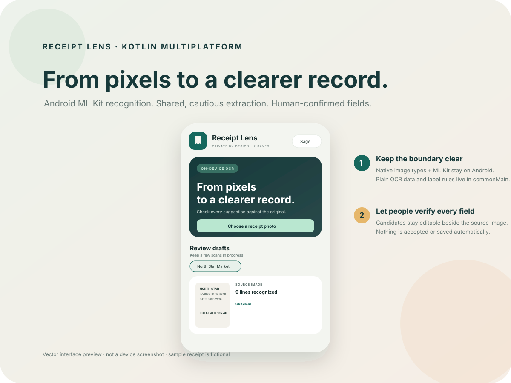

<div align="center">
  
  <h1>Receipt Lens KMP</h1>
  <p><strong>From pixels to a clearer record.</strong><br/>Android ML Kit OCR with a Kotlin Multiplatform core for careful, editable receipt review.</p>
  <p>
    
    
    
  </p>
</div>



> The artwork above is a vector interface preview, not a device screenshot. The sample receipt is fictional.

## Why this project

This app follows the architecture in [From Pixels to Text: Google ML Kit OCR on Android, with a KMP Core](https://prem1997.hashnode.dev/from-pixels-to-text-google-ml-kit-ocr-on-android-with-a-kmp-core): keep Android image and recognition APIs at the Android boundary, move plain OCR data and cautious parsing rules into Kotlin Multiplatform `commonMain`, and put a human review step between recognition and saving.

## What it does

- Pick one image through Android's system photo picker, without broad photo-library or camera permissions.
- Try a built-in high-resolution sample receipt without selecting a file.
- Run bundled Google ML Kit Text Recognition v2 for Latin-script text on Android.
- Keep multiple in-progress reviews so a poor or new scan does not erase another draft.
- Suggest merchant, invoice number, printed date, and printed total using small label-based rules in shared Kotlin.
- Show the source image beside editable fields and the complete recognized text.
- Distinguish preparation, recognition failure, no readable text, and a successful review.
- Save only after a person confirms the fields; switch among Sage, Midnight, and Clay themes.

## Architecture

```text
Android Photo Picker / local sample
                 ↓
Android image preparation + Google ML Kit Text Recognition v2
                 ↓
Android adapter maps native result → OcrDocument
                 ↓
commonMain normalizes lines + proposes labelled field candidates
                 ↓
Android Compose review: source image + editable values
                 ↓
Person confirms → session-only saved shelf
```

- `:androidApp` owns Android photo selection, `Uri` and `Bitmap` handling, the ML Kit adapter, and the Compose UI.
- `:shared` is a Kotlin Multiplatform library. Its common API contains only plain Kotlin OCR models and deterministic candidate extraction. It builds Android and iOS framework targets.
- An iOS host can reuse the shared model and extraction contract, but an iOS recognizer and iOS review UI are not implemented in this project yet. Google Android ML Kit classes are never called from `commonMain`.

## Privacy and storage

- The app has no account, backend, network client, or upload flow. It does not request camera or broad storage permissions; Android's picker grants access to the selected image.
- The bundled recognizer keeps the text model with the Android app, so the first scan does not wait for a Play-services model download. This increases app size. Google describes ML Kit recognition as on-device processing; review the [ML Kit terms and privacy guidance](https://developers.google.com/ml-kit/terms) for SDK-level diagnostics and service behavior.
- The app keeps the selected image, recognized text, and draft fields in memory only. The session shelf retains only the reviewed fields, not the source image or full OCR text. Closing the process clears all of them. It does not write receipt data to files, logs, analytics, or a database.

## Recognition limits

OCR returns text, not verified receipt data. The shared extractor recognizes a few explicit labels and the top line as a merchant suggestion; it does not understand arbitrary invoice layouts or prove a total is correct. Every field remains editable and is shown with the image for review. The bundled recognizer here is Latin-script only; this demo does not promise Arabic or Urdu recognition. Image focus, lighting, rotation, crop, and character size affect results.

## Build

Use JDK 17 and Android SDK Platform 35. The wrapper pins Gradle 8.12.1.

```sh
./gradlew :androidApp:assembleDebug
./gradlew :shared:linkDebugFrameworkIosSimulatorArm64
```

The Android debug APK is written to `androidApp/build/outputs/apk/debug/`. GitHub Actions assembles Android and links the iOS simulator framework on pushes and pull requests to `main`.

## References

- [Google ML Kit: Text Recognition v2 on Android](https://developers.google.com/ml-kit/vision/text-recognition/v2/android)
- [Google ML Kit: Text Recognition v2 supported languages](https://developers.google.com/ml-kit/vision/text-recognition/v2/languages)
- [Android Developers: Photo Picker](https://developer.android.com/training/data-storage/shared/photopicker)
- [Original architecture article](https://prem1997.hashnode.dev/from-pixels-to-text-google-ml-kit-ocr-on-android-with-a-kmp-core)
